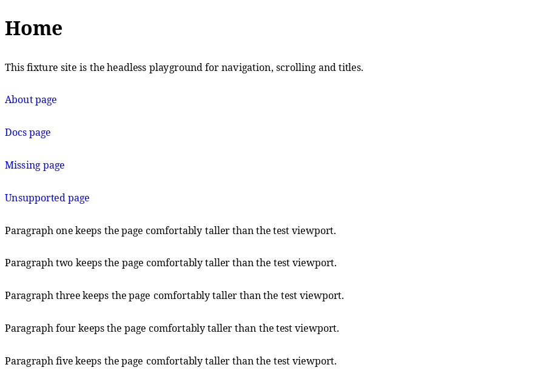
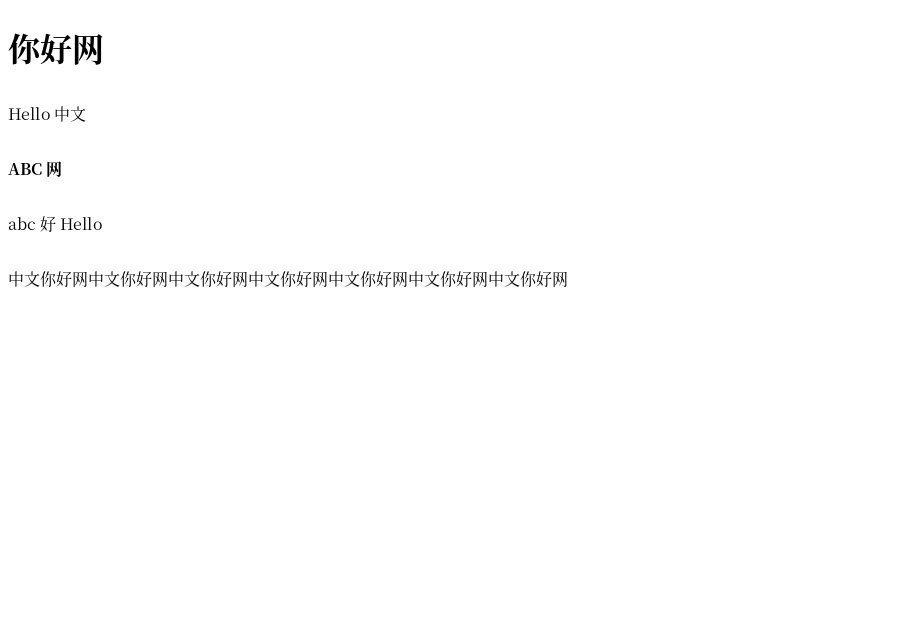

# toybrowser

> [!IMPORTANT]
> **AI disclosure — please read first.** This project is built with heavy use of AI: large parts of
> the code, tests, documentation and commit messages are generated by LLM-based coding agents under
> human direction and review. The human maintainer sets the goals, approves dependencies, reviews
> the changes and is responsible for the final result. See [AI-DISCLOSURE.md](AI-DISCLOSURE.md).

A browser engine written from scratch in C++20: URL fetching, HTML and CSS parsing, style
resolution, layout, painting, real font rendering and PNG images, presented headlessly or in a small
X11 window. The browser parts are implemented in this repository rather than delegated to an
existing engine; low-level libraries are used only for TLS, image decoding, font machinery and the
window system.

The project is a learning exercise, not a production browser: it deliberately implements a small,
well-understood subset of the web and grows one minimal vertical slice at a time.



## What works

- `http://`, `https://` and `file://` URLs, redirects, chunked responses and a body size cap.
  HTTPS uses OpenSSL with certificate and hostname verification always on — there is no insecure
  mode.
- A hand-written HTML parser and CSS parser. The style engine covers the selectors, cascade and
  computed values that the supported pages need; layout is block/inline flow with line breaking,
  replaced `` elements and integer-pixel device rectangles.
- External author stylesheets (M12): `<link rel="stylesheet">` sheets are discovered in document
  order, filtered on `rel`/`disabled`/`media`/`type`, resolved against the page's final URL after
  redirects, fetched and cascaded with inline `<style>` and `style` attributes; missing, failed and
  unsupported sheets are skipped silently. This is what makes most real pages look styled.
- Resource loading (M13): one keep-alive HTTP/1.1 connection per origin is reused for the page, its
  stylesheets and its images, gzip responses are decoded transparently, and repeated image URLs are
  fetched/decoded once per page. This roughly halves the measured load time of image-heavy real
  pages without changing a pixel.
- CSS values & typography (M14a): `%`/`rem` lengths, `rgb()`/`rgba()`/`hsl()`/`hsla()` and named
  colors, the color part of the `background` shorthand, logical properties, min/max sizes,
  `margin: auto` centering, `line-height`, `text-align`, `text-decoration: underline` and
  `visibility` are parsed, cascaded and laid out; real pages now keep their intended line spacing,
  centering and hidden content instead of collapsing into overlapped text.
- Box decorations & constraints (M14b): `border`/`border-*` width, style and color (longhands and
  shorthands, painted on all four sides), `box-sizing: content-box|border-box`,
  `overflow: hidden` clipping and the `line-through`/`overline` decorations; this paints real-page
  navigation/chrome borders and clips overflowing content.
- Real text: freetype rasterization and harfbuzz shaping, automatic font selection through
  fontconfig (computed `font-family`/`font-weight`/`font-style`, character-coverage fallback,
  CJK break units) and a built-in bitmap font as the last-resort deterministic fallback.
- PNG and JPEG/JPG images decoded with the approved libpng and libjpeg libraries and drawn with
  nearest-neighbour scaling (content-detected, so mixed-format pages work; JPEG EXIF orientation and
  ICC profiles are ignored).
- A navigable X11 window (clickable links, wheel/keyboard scrolling, Alt+Left/Right history, window
  title) and fully headless `--dump-*`/`--screenshot` modes for debugging and tests.
- A small, deterministic test suite (88 CTest cases) and CI that builds it warning-free with GCC
  and Clang.

Chinese text is rendered with automatic font fallback and wraps without spaces:



The screenshots above are headless captures of the committed fixture pages; their exact appearance
depends on the fonts installed on the machine.

## Quick start

Requirements: Linux, CMake 3.20 or newer, and a C++20 compiler. Build dependencies (Debian/Ubuntu
package names): `cmake g++ clang libx11-dev libpng-dev libjpeg-dev libfreetype-dev
libharfbuzz-dev libfontconfig1-dev libssl-dev`. Other distributions provide equivalent packages.

```sh
# Configure and build a developer tree with tests and warnings-as-errors.
cmake --preset dev
cmake --build --preset dev
ctest --test-dir build-dev --output-on-failure

# Plain build (tests are opt-in, so this only builds the browser itself).
cmake -S . -B build
cmake --build build

# Optional: install the executable and the README/LICENSE documentation.
cmake --install build --prefix "$HOME/.local"
```

No CMake presets? The equivalent explicit configuration is:

```sh
cmake -S . -B build-dev -DTOYBROWSER_BUILD_TESTS=ON -DTOYBROWSER_WERROR=ON
cmake --build build-dev
ctest --test-dir build-dev --output-on-failure
```

The default build type is `RelWithDebInfo` when `CMAKE_BUILD_TYPE` is not set; pass
`-DCMAKE_BUILD_TYPE=Debug` for unoptimised debugging.

## Try it

The repository contains small offline demo pages so nothing here needs the public network:

```sh
# Window: click links, scroll with the wheel/keys, Alt+Left/Right for history.
./build/toybrowser "file://$PWD/tests/fixtures/nav_site/index.html"

# Headless screenshot of the same page (no display required).
./build/toybrowser --size 800x600 --screenshot out.ppm \
    "file://$PWD/tests/fixtures/nav_site/index.html"

# Real text + image demo with the committed fixture font (deterministic).
./build/toybrowser --size 480x600 --screenshot font.ppm \
    --font tests/fixtures/fonts/toy_test.ttf \
    "file://$PWD/tests/fixtures/font_site/index.html"

# Automatic font selection and readable Chinese wrapping.
./build/toybrowser --size 800x600 --screenshot cjk.ppm \
    "file://$PWD/tests/fixtures/cjk_site/index.html"

# PNG image pipeline.
./build/toybrowser --size 480x400 --screenshot img.ppm \
    "file://$PWD/tests/fixtures/img_site/index.html"

# External stylesheets: the sheet in styles/ is fetched and cascaded.
./build/toybrowser --size 480x300 --dump-style \
    "file://$PWD/tests/fixtures/css_site/index.html"
```

| Fixture | What it demonstrates |
| --- | --- |
| [`tests/fixtures/nav_site/`](tests/fixtures/nav_site/) | Navigation, scrolling, titles and history |
| [`tests/fixtures/font_site/`](tests/fixtures/font_site/) | Real TTF text (regular/bold/italic fixtures) and images |
| [`tests/fixtures/cjk_site/`](tests/fixtures/cjk_site/) | Automatic font fallback, CJK line breaking and wrapping |
| [`tests/fixtures/img_site/`](tests/fixtures/img_site/) | PNG decoding and inline replaced elements |
| [`tests/fixtures/css_site/`](tests/fixtures/css_site/) | External `<link rel="stylesheet">` loading, filtering and document-order cascade |
| [`tests/fixtures/https_site/`](tests/fixtures/https_site/) | HTTPS end-to-end through the loopback TLS test server |

Headless inspection is the primary debugging path. Every stage has a dump mode:

```sh
./build/toybrowser --dump-body  "file://$PWD/tests/fixtures/nav_site/index.html"
./build/toybrowser --dump-dom   "file://$PWD/tests/fixtures/nav_site/index.html"
./build/toybrowser --dump-style "file://$PWD/tests/fixtures/nav_site/index.html"
./build/toybrowser --dump-boxes "file://$PWD/tests/fixtures/nav_site/index.html"
```

Public-network fetches are optional manual checks, not part of the test suite:

```sh
./build/toybrowser --dump-body https://example.com/
./build/toybrowser --size 1024x768 --screenshot page.ppm https://example.com/
```

## Project layout

```
src/
  main.cpp          command-line parsing and the dump/screenshot entry points
  platform/         X11 window, input events, pixel presentation
  net/              URLs, HTTP/1.1 and the HTTPS transport
  dom/  css/  style/  HTML parsing, CSS parsing, cascade and computed styles
  layout/           box tree, line breaking, text metrics callback
  paint/            display-list construction and viewport culling
  render/           software rasterizer, surfaces, PNG decoding, fonts
  shell/            browser session, page loading, font selection, window loop
tests/              CTest suites plus committed deterministic fixtures/generators
docs/               architecture, roadmap, decisions, conventions, handoff notes
```

Module boundaries and the dependency direction are described in
[docs/architecture.md](docs/architecture.md). Every module has a public header under
`src/<module>/include/toy/<module>/` and a small private implementation; the renderer knows
nothing about HTML/CSS and the platform layer knows nothing about page content.

## Status and limitations

Milestones M0–M14 are complete (M14 = CSS compatibility batch 1), and M17 (JPEG/JPG image support)
was delivered out of sequence at the maintainer's request: the browser renders real pages with their
external stylesheets, loads their resources over reused keep-alive connections with gzip, applies the
high-frequency CSS value/typography properties (units, colors, line-height, text-align, visibility,
min/max sizes and auto margins) and the box decorations (borders, box-sizing, overflow clipping,
underline/line-through/overline), decodes PNG and JPEG images, supports real fonts, speaks HTTPS and
has a navigable window. The next planned milestone is a flexbox/position/float subset (M15). HTTP
proxy support (M16) and the JavaScript subset are deferred.

Known limits, by design of the current milestone set:

- HTML/CSS support is a small subset: no JavaScript, forms, tables, floats, flexbox/grid,
  `border-radius`, `box-shadow`, position beyond static flow, horizontal scrolling or scrollbars;
  external stylesheets work their subset only (no `@import`, media queries, webfonts or CSS images
  yet, M15); percentage heights and `justify` alignment are not implemented; every border style
  paints solid, percentage border widths are ignored and `overflow: hidden` clips painting without
  scrollbars.
- Text support is best-effort for scripts beyond Latin and Chinese; no bidi/RTL ordering and no
  full Unicode line breaking.
- No proxy support (M16), no HTTP caching headers or cookies, and no parallel resource loading,
  cross-page image cache or lazy loading yet; requests are serial, with keep-alive, gzip and
  per-page image deduplication only (M13).
- JPEG support (M17) ignores EXIF orientation and ICC/color management, assumes the standard
  Adobe-inverted CMYK convention, and decodes are lossy; GIF/WebP/SVG, `background-image` and
  `srcset` are not supported yet. Some real-site JPEGs stay invisible while `display:block`
  replaced elements are unsupported (M15).
- Rendering is software-only and single-threaded; there is no GPU backend, and presentation sends
  the whole frame to the X server.
- Not security-hardened: treat fetched pages as untrusted input, do not enter secrets into it.

The full, current list lives in [docs/roadmap.md](docs/roadmap.md) and
[docs/handoff.md](docs/handoff.md).

## Documentation

| Document | Content |
| --- | --- |
| [AI-DISCLOSURE.md](AI-DISCLOSURE.md) | How this project uses AI and what it means for readers |
| [docs/README.md](docs/README.md) | Documentation index and reading order |
| [docs/architecture.md](docs/architecture.md) | Module map, data flow, data model, rendering and threading |
| [docs/roadmap.md](docs/roadmap.md) | Milestones, acceptance criteria, known limits and backlog |
| [docs/decisions.md](docs/decisions.md) | Locked technical decisions and their rationale |
| [docs/dependencies.md](docs/dependencies.md) | Third-party dependency policy and approval log |
| [docs/conventions.md](docs/conventions.md) | C++, CMake and testing conventions |
| [docs/handoff.md](docs/handoff.md) | Current development state, verification steps and takeover guide |
| [CONTRIBUTING.md](CONTRIBUTING.md) | How to build, test, and contribute |
| [SECURITY.md](SECURITY.md) | Security model, test-only keys and reporting |

Chinese translations live under [docs/zh/](docs/zh/); English is the source of truth.

## Dependencies

Seven third-party packages are linked today; the browser engine itself has no ready-made components.

| Component | Purpose | License |
| --- | --- | --- |
| C++20 standard library + POSIX | baseline (containers, sockets, files) | standard / OS |
| libX11 | window, input, pixel presentation | MIT/X11 |
| libpng + zlib | PNG image decoding | libpng license / zlib license |
| libjpeg (libjpeg-turbo) | JPEG/JPG image decoding | IJG license / BSD-3-Clause |
| freetype | font metrics and glyph rasterization | FreeType License |
| harfbuzz | OpenType text shaping | MIT |
| fontconfig | automatic font discovery/matching and character fallback | MIT-style |
| OpenSSL | TLS for `https://` | Apache-2.0 |

All of them are permissive and compatible with this project's MIT license. The policy, approval
log and from-scratch alternatives are in [docs/dependencies.md](docs/dependencies.md).

## Contributing

Contributions are welcome. Start with [CONTRIBUTING.md](CONTRIBUTING.md) and keep the changes small
and verifiable: build with tests, run `ctest`, and update the relevant docs and fixtures in the same
change. The repository is developed with AI agents, so [AGENTS.md](AGENTS.md) and
[docs/team-workflow.md](docs/team-workflow.md) document the working rules and process as well.

## License

MIT — see [LICENSE](LICENSE).
