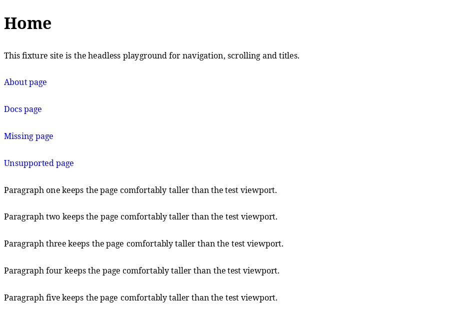
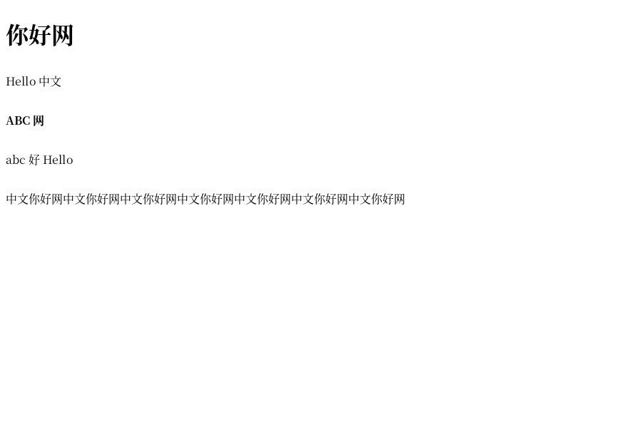

# toybrowser

> [!IMPORTANT]
> **AI 使用声明——请先阅读。** 本项目大量使用 AI：代码、测试、文档与提交消息中的很大一部分由大语言
> 模型编码 agent 在人类指导下生成并审查。人类维护者设定目标、批准依赖、审查改动，并对最终结果负责。
> 详见 [AI-DISCLOSURE.md](docs/zh/AI-DISCLOSURE.md)。

一个用 C++20 从零实现的浏览器引擎：URL 抓取、HTML/CSS 解析、样式计算、布局、绘制、真实字体与
PNG 图片，可 headless 运行，也可在小型 X11 窗口中浏览。浏览器功能都在本仓库实现，而不是交给现成
引擎；第三方库只用于 TLS、图片解码、字体机制与窗口系统。

这是一个学习项目，不是生产浏览器：它有意识地只实现一小块可理解的 Web 子集，并一次增加一个最小
可验证的垂直切片。



## 目前已实现

- `http://`、`https://` 与 `file://` URL、重定向、chunked 响应与 body 大小上限。HTTPS 使用
  OpenSSL，证书与主机名校验始终开启，没有 insecure 模式。
- 手写 HTML 解析器与 CSS 解析器；样式引擎覆盖受支持页面所需的 selector、级联与计算值；布局是
  块级/行内流，支持换行、替换元素 `` 与整数像素设备矩形。
- 外部作者样式表（M12）：按文档顺序发现 `<link rel="stylesheet">`，按 `rel`/`disabled`/`media`/
  `type` 过滤，相对重定向后的最终 URL 解析并抓取，再与内联 `<style>`、`style` 属性一起级联；
  缺失、失败与不支持的样式表会静默跳过。这是大多数真实页面看起来有样式的关键。
- 资源加载（M13）：每个 origin 复用一条 keep-alive HTTP/1.1 连接来抓取页面、其样式表与图片，
  透明解码 gzip 响应，同一页面内重复的图片 URL 只抓取/解码一次。这让图片较多的真实页面实测加载
  时间大约减半，而像素完全不变。
- CSS 值与排版（M14a）：`%`/`rem` 长度、`rgb()`/`rgba()`/`hsl()`/`hsla()` 与命名颜色、
  `background` 简写的颜色部分、逻辑属性、min/max 尺寸、`margin: auto` 居中、`line-height`、
  `text-align`、`text-decoration: underline` 与 `visibility` 都会参与解析、级联与布局；真实页面
  现在能保持预期的行距、居中与隐藏内容，而不是让文字重叠塌陷。
- 真实文本：freetype 光栅化 + harfbuzz 整形，通过 fontconfig 自动选择字体（计算出的
  `font-family`/`font-weight`/`font-style`、字符覆盖回退、CJK 断行单元），并以内置位图字体作为
  最后的确定性回退。
- 用 libpng 解码 PNG 图片，最近邻缩放绘制。
- 可导航的 X11 窗口（链接可点击、滚轮/键盘滚动、Alt+Left/Right 历史、窗口标题）与完整的
  headless `--dump-*`/`--screenshot` 调试模式。
- 一套小而有确定性的测试（80 个 CTest 用例），CI 用 GCC 与 Clang 无警告构建并运行。

中文文本会通过自动字体回退渲染，并在没有空格时正常换行：



上面的截图是仓库内 fixture 页面的 headless 截图；具体外观取决于已安装的字体。

## 快速开始

需要 Linux、CMake 3.20 或更新版本，以及任意 C++20 编译器。构建依赖（Debian/Ubuntu 包名）：
`cmake g++ clang libx11-dev libpng-dev libfreetype-dev libharfbuzz-dev libfontconfig1-dev
libssl-dev`；其他发行版有对应包。

```sh
# 配置并构建带测试、warnings-as-errors 的开发树。
cmake --preset dev
cmake --build --preset dev
ctest --test-dir build-dev --output-on-failure

# 普通构建（测试是 opt-in 的，因此只构建浏览器本体）。
cmake -S . -B build
cmake --build build

# 可选：安装可执行文件与 README/LICENSE 文档。
cmake --install build --prefix "$HOME/.local"
```

不使用 CMake presets 时，等价的显式配置是：

```sh
cmake -S . -B build-dev -DTOYBROWSER_BUILD_TESTS=ON -DTOYBROWSER_WERROR=ON
cmake --build build-dev
ctest --test-dir build-dev --output-on-failure
```

未指定 `CMAKE_BUILD_TYPE` 时默认使用 `RelWithDebInfo`；调试时传 `-DCMAKE_BUILD_TYPE=Debug`。

## 试用

仓库内自带离线演示页面，不需要公网：

```sh
# 窗口：点击链接、滚轮/键盘滚动、Alt+Left/Right 前进后退。
./build/toybrowser "file://$PWD/tests/fixtures/nav_site/index.html"

# 同一页面的 headless 截图（不需要显示器）。
./build/toybrowser --size 800x600 --screenshot out.ppm \
    "file://$PWD/tests/fixtures/nav_site/index.html"

# 真实字体 + 图片演示，使用仓库内 fixture 字体（确定性）。
./build/toybrowser --size 480x600 --screenshot font.ppm \
    --font tests/fixtures/fonts/toy_test.ttf \
    "file://$PWD/tests/fixtures/font_site/index.html"

# 自动字体选择与可读的中文换行。
./build/toybrowser --size 800x600 --screenshot cjk.ppm \
    "file://$PWD/tests/fixtures/cjk_site/index.html"

# PNG 图片管线。
./build/toybrowser --size 480x400 --screenshot img.ppm \
    "file://$PWD/tests/fixtures/img_site/index.html"

# 外部样式表：styles/ 下的样式表会被抓取并级联。
./build/toybrowser --size 480x300 --dump-style \
    "file://$PWD/tests/fixtures/css_site/index.html"
```

| Fixture | 演示内容 |
| --- | --- |
| [`tests/fixtures/nav_site/`](tests/fixtures/nav_site/) | 导航、滚动、标题与历史 |
| [`tests/fixtures/font_site/`](tests/fixtures/font_site/) | 真实 TTF 文本（常规/粗体/斜体 fixture）与图片 |
| [`tests/fixtures/cjk_site/`](tests/fixtures/cjk_site/) | 自动字体回退、CJK 断行与换行 |
| [`tests/fixtures/img_site/`](tests/fixtures/img_site/) | PNG 解码与行内替换元素 |
| [`tests/fixtures/css_site/`](tests/fixtures/css_site/) | 外部 `<link rel="stylesheet">` 加载、过滤与文档序级联 |
| [`tests/fixtures/https_site/`](tests/fixtures/https_site/) | 通过 loopback TLS 测试服务器的 HTTPS 端到端流程 |

Headless 检查是主要调试路径，每个阶段都有 dump 模式：

```sh
./build/toybrowser --dump-body  "file://$PWD/tests/fixtures/nav_site/index.html"
./build/toybrowser --dump-dom   "file://$PWD/tests/fixtures/nav_site/index.html"
./build/toybrowser --dump-style "file://$PWD/tests/fixtures/nav_site/index.html"
./build/toybrowser --dump-boxes "file://$PWD/tests/fixtures/nav_site/index.html"
```

公网抓取只是可选的手工检查，不属于测试套件：

```sh
./build/toybrowser --dump-body https://example.com/
./build/toybrowser --size 1024x768 --screenshot page.ppm https://example.com/
```

## 项目结构

```
src/
  main.cpp          命令行解析与 dump/screenshot 入口
  platform/         X11 窗口、输入事件、像素呈现
  net/              URL、HTTP/1.1 与 HTTPS 传输
  dom/  css/  style/  HTML 解析、CSS 解析、级联与计算样式
  layout/           盒树、断行、文本度量回调
  paint/            显示列表构建与视口裁剪
  render/           软件光栅化、surface、PNG 解码、字体
  shell/            浏览器会话、页面加载、字体选择、窗口循环
tests/              CTest 测试套件与提交的确定性 fixture/生成器
docs/               架构、路线图、决策、约定、接管笔记
```

模块边界与依赖方向见 [docs/zh/architecture.md](docs/zh/architecture.md)。每个模块的公开头文件位于
`src/<module>/include/toy/<module>/`，实现保持私有；渲染器不知道 HTML/CSS，平台层不知道页面内容。

## 状态与限制

里程碑 M0–M14a 已完成：浏览器能渲染真实页面及其外部样式表、通过复用的 keep-alive 连接与 gzip
加载资源、应用高频 CSS 值与排版属性（单位、颜色、line-height、text-align、visibility、min/max
尺寸与 auto margin）、支持真实字体与图片、支持 HTTPS，并有可导航窗口。下一个计划里程碑是 M14b
（盒装饰与约束：border、box-sizing、overflow 裁剪、line-through/overline），随后是
flexbox/position/float 子集（M15）。HTTP 代理（M16）与 JavaScript 子集已延后。

当前里程碑集刻意保留的限制：

- HTML/CSS 只支持一个小子集：没有 JavaScript、表单、表格、float、flexbox/grid、border、
  `border-radius`、`box-sizing`、`overflow` 裁剪、`box-shadow`、`text-decoration` 的
  line-through/overline、水平滚动或滚动条；外部样式表只覆盖这个子集（还没有 `@import`、媒体查询、
  webfont 或 CSS 图片，M14b/M15）；百分比高度与 `justify` 对齐尚未实现。
- 拉丁与中文之外的文字是尽力支持；没有 bidi/RTL 排序，也没有完整的 Unicode 断行。
- 还没有代理（M16）、HTTP 缓存头或 cookie，也没有并行资源加载、跨页面图片缓存或懒加载；请求仍是
  串行的，只有 keep-alive、gzip 与页面内的图片去重（M13）。
- 渲染是纯软件、单线程；没有 GPU 后端，呈现时整帧发送给 X server。
- 没有做安全加固：把抓取到的页面当作不可信输入，不要在其中输入敏感信息。

完整且最新的限制列表见 [docs/zh/roadmap.md](docs/zh/roadmap.md) 与
[docs/zh/handoff.md](docs/zh/handoff.md)。

## 文档

| 文档 | 内容 |
| --- | --- |
| [AI-DISCLOSURE.md](docs/zh/AI-DISCLOSURE.md) | 本项目如何使用 AI，以及对读者意味着什么 |
| [docs/zh/README.md](docs/zh/README.md) | 文档索引与阅读顺序 |
| [docs/zh/architecture.md](docs/zh/architecture.md) | 模块划分、数据流、数据模型、渲染与线程模型 |
| [docs/zh/roadmap.md](docs/zh/roadmap.md) | 里程碑、验收标准、已知限制与 backlog |
| [docs/zh/decisions.md](docs/zh/decisions.md) | 已锁定的技术决策及理由 |
| [docs/zh/dependencies.md](docs/zh/dependencies.md) | 第三方依赖策略与审批记录 |
| [docs/zh/conventions.md](docs/zh/conventions.md) | C++、CMake 与测试约定 |
| [docs/zh/handoff.md](docs/zh/handoff.md) | 当前开发状态、验证步骤与接管指南 |
| [CONTRIBUTING.md](docs/zh/CONTRIBUTING.md) | 如何构建、测试与贡献 |
| [SECURITY.md](docs/zh/SECURITY.md) | 安全模型、测试专用密钥与问题报告 |

中文翻译位于 [docs/zh/](docs/zh/)；英文是唯一权威版本。

## 依赖

目前链接了六个第三方包；浏览器引擎本身没有任何现成组件。

| 组件 | 用途 | 许可证 |
| --- | --- | --- |
| C++20 标准库 + POSIX | 基础（容器、socket、文件） | 标准 / 系统 |
| libX11 | 窗口、输入、像素呈现 | MIT/X11 |
| libpng + zlib | PNG 图片解码 | libpng 许可证 / zlib 许可证 |
| freetype | 字体度量与字形光栅化 | FreeType 许可证 |
| harfbuzz | OpenType 文本整形 | MIT |
| fontconfig | 自动字体发现/匹配与字符回退 | MIT 风格 |
| OpenSSL | `https://` 的 TLS | Apache-2.0 |

它们都使用与 MIT 兼容的宽松许可证。策略、审批记录与自写替代方案见
[docs/zh/dependencies.md](docs/zh/dependencies.md)。

## 贡献

欢迎贡献。先读 [CONTRIBUTING.md](docs/zh/CONTRIBUTING.md)，保持改动小且可验证：带测试构建、运行
`ctest`，并在同一改动中更新相关文档与 fixture。仓库使用 AI agent 开发，因此
[AGENTS.md](AGENTS.md) 与 [docs/zh/team-workflow.md](docs/zh/team-workflow.md) 也记录了工作规则与流程。

## 许可证

MIT —— 见 [LICENSE](LICENSE)。
